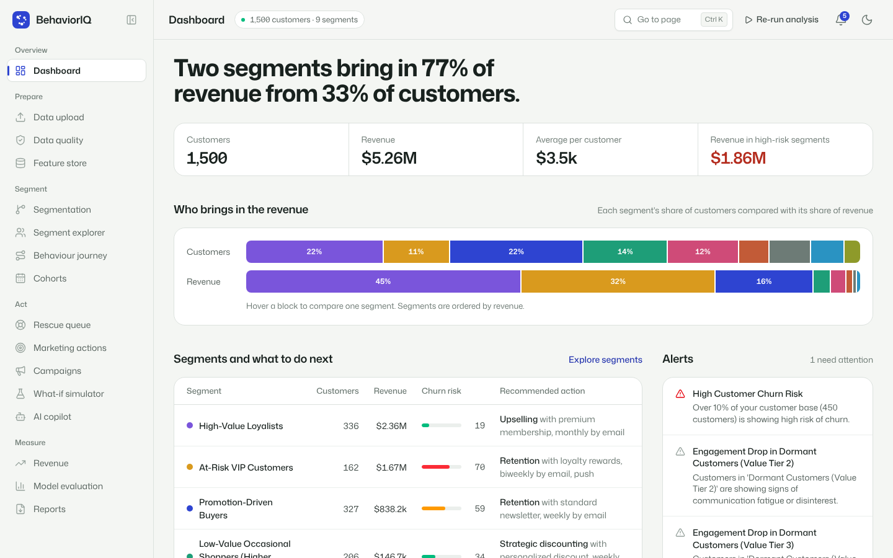
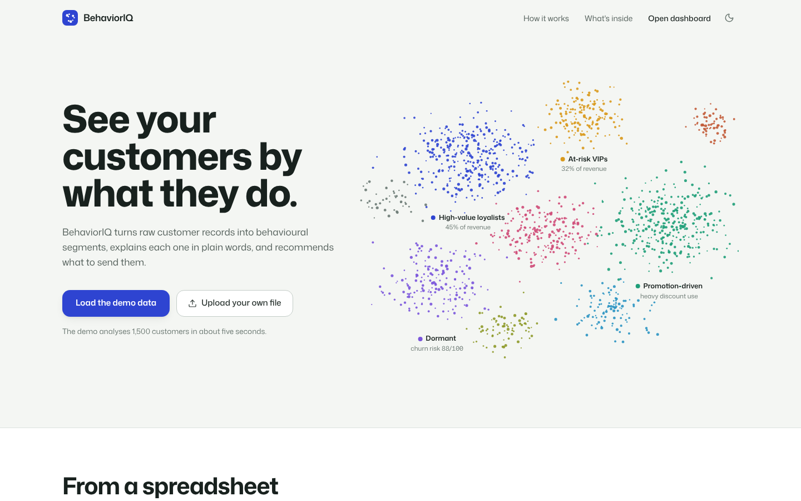
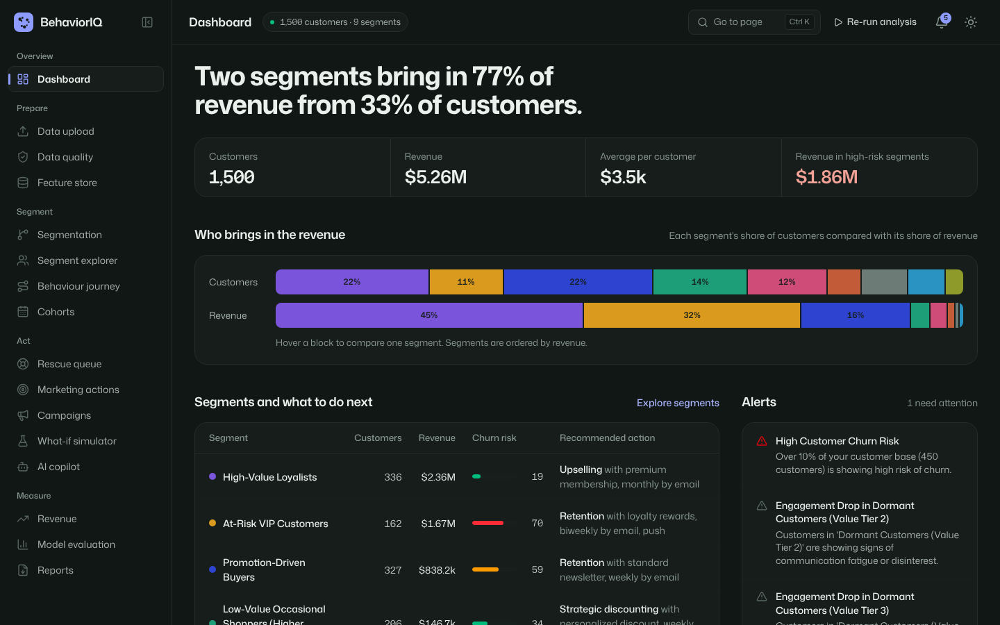
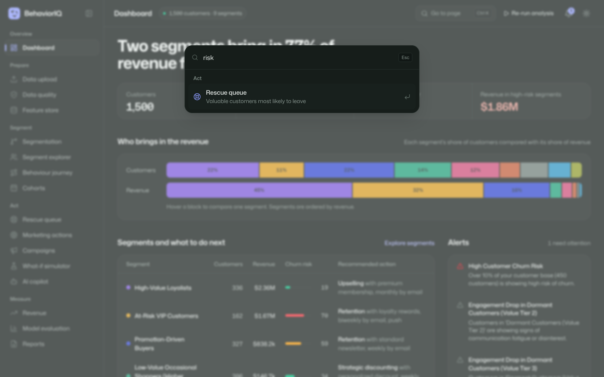
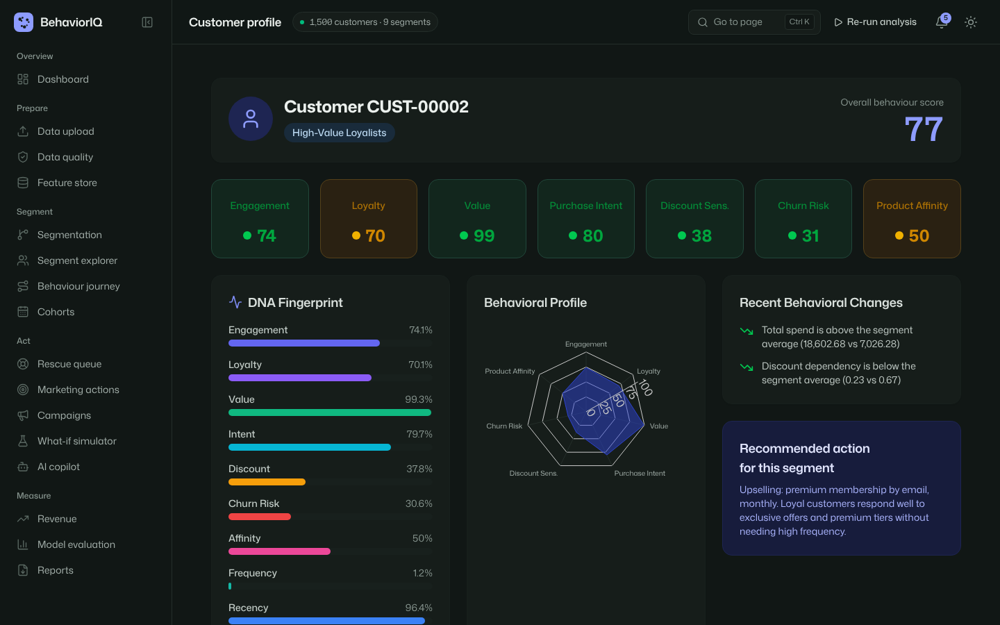

# BehaviorIQ — Behavioral Customer Segmentation & Personalized Marketing Intelligence Platform

> **OBSERVE → UNDERSTAND → PREDICT → ACT → MEASURE**

A production-quality full-stack AI platform that analyzes real customer behavior across purchase history, engagement patterns, and product usage to automatically discover meaningful customer segments, generate behavioral scores, and produce specific marketing actions for every segment.

## 🎬 Demo



A one-minute walkthrough is in [`docs/demo/BehaviorIQ_UI_demo.mp4`](docs/demo/BehaviorIQ_UI_demo.mp4): landing page, dashboard, command palette, segment explorer, rescue queue, customer profile and dark mode.

| Landing | Dark mode |
|---|---|
|  |  |
|  |  |

### Interface highlights
- **Light and dark themes** that follow your system setting and remember your choice.
- **Ctrl/⌘ K command palette** to jump to any page, or straight to a customer by ID (e.g. `CUST-00042`).
- **Sidebar grouped by workflow**: Prepare → Segment → Act → Measure.
- **Dashboard** that leads with the finding (which segments bring in the revenue), with a segment table, churn risk and the next action for each segment.
- **Live status and alert count** from the backend, with no placeholder numbers.
- Works on phones (drawer navigation, no sideways scrolling), keyboard focus is visible, and reduced-motion settings are respected.

## 🚀 Quick Start

### Prerequisites
- Python 3.10+
- Node.js 18+
- npm

### 1. Install Backend Dependencies
```bash
cd behavioriq
pip install -r requirements.txt
```

### 2. Install Frontend Dependencies
```bash
cd frontend
npm install
```

### 3. Set Up Environment (Optional)
```bash
cp .env.example .env
# Edit .env and add your GEMINI_API_KEY for AI features
# The app works without it — AI features will use rule-based fallback
```

### 4. Start Backend
```bash
# From the behavioriq root directory
python -m uvicorn backend.main:app --reload --host 0.0.0.0 --port 8000
```

### 5. Start Frontend
```bash
cd frontend
npm run dev
```

### 6. Open the App
Visit **http://localhost:5173** → Click "Try Demo Data" on the landing page → The system generates 1,500 synthetic customers and runs the full ML pipeline automatically (about 4 seconds).

---

## 📊 What This Platform Does

1. **Data Ingestion**: Upload CSV/Excel or generate realistic synthetic customers
2. **Feature Engineering**: 31 behavioral features auto-generated (RFM, engagement, purchase, loyalty, churn signals)
3. **Behavior Scoring**: 7 individual scores + PCA-weighted composite per customer
4. **Multi-Model Segmentation**: K-Means, Hierarchical, DBSCAN, GMM — all compared over 4–10 segments, skewed features log-transformed
5. **Intelligent Naming**: Segments named from behavior (e.g., "High-Value Loyalists" not "Cluster 0")
6. **Explainability**: Feature importance, radar charts, heatmaps, natural-language explanations
7. **Marketing Actions**: Per-segment strategy, channel, offer, frequency, objective
8. **AI Copilot**: Ask marketing questions grounded in actual data
9. **Campaign Generator**: Full campaign copy (email, SMS, push) per segment
10. **What-If Simulator**: Estimate impact of marketing actions
11. **Revenue Intelligence**: Autopsy + forecasting per segment
12. **Customer Rescue Queue**: Priority-ranked at-risk customers

## 🧬 Unique Features

- **Customer DNA Fingerprint**: Visual barcode of behavioral profile
- **Behavioral Anomaly Radar**: Catches behavioral shifts before churn
- **Marketing Fatigue Index**: Prevents over-contacting
- **Micro-Segment Discovery**: Niche sub-segments within primary segments
- **Golden Hour Detection**: Best time/day to contact each segment
- **Segment Gravity Map**: How segments naturally attract customers
- **Cohort Comparison**: Compare customer cohorts by signup period
- **Smart Alert System**: Proactive alerts for behavioral shifts

## 🏗 Architecture

```
behavioriq/
├── backend/              # Python FastAPI
│   ├── main.py           # App entry point
│   ├── ml/               # ML pipeline (12 modules)
│   ├── ai/               # LLM integration
│   ├── services/         # Business logic (8 services)
│   ├── routers/          # API endpoints (9 routers)
│   └── utils/            # Helpers & exporters
├── frontend/             # React + TypeScript + Tailwind
│   └── src/
│       ├── pages/        # 18 pages (landing + 16 app views + customer profile)
│       ├── lib/          # navigation map, palette
│       ├── components/   # Reusable UI components
│       ├── services/     # API client
│       └── stores/       # Zustand state
└── data/                 # Datasets & exports
```

## 🔬 Reproducing the research results

```bash
python -m experiments.run_experiments   # 5 seeds x 5 preprocessing variants x 4 algorithms (~2-3 min)
python -m experiments.make_figures      # figures -> experiments/figures/
python -m experiments.make_tables       # LaTeX tables -> experiments/tables/
```

The synthetic generator draws customers from 8 known behavioural archetypes, so segment quality is measured against ground truth (ARI / NMI), not only with internal indices. Headline results (mean over 5 seeds): log-transforming skewed features raises best ARI from 0.54–0.62 to 0.66–0.71; unconstrained silhouette selection picks 2–3 segments (ARI ≈ 0.2); restricting to 4–10 segments gives ARI 0.51 at ≈ 8 segments.

## 📄 Dataset Format

The system accepts CSV/Excel with customer behavioral data. Minimum required columns:
- `customer_id`, `total_spending`, `order_count`, `last_purchase_date`

See the full dataset specification in the implementation plan for all supported columns.

## 🔧 Tech Stack

| Layer | Technology |
|-------|-----------|
| Frontend | React 19, TypeScript, Tailwind CSS 4, Recharts, Framer Motion, Mona Sans |
| Backend | Python, FastAPI, Pydantic |
| ML | scikit-learn, pandas, numpy, scipy |
| AI | Google Gemini API (optional, has rule-based fallback) |
| Database | In-memory (SQLite-ready) |

## 📝 License

MIT
